# Etapa 3 — carga reproducible

Ejecutar desde la raíz `proyecto`. El generador **sólo acepta una base nueva** cuyo nombre termina en `_test` o `_dev`. No crea, borra, vacía ni modifica una base ya poblada. Usa `PGHOST`, `PGPORT`, `PGUSER`, `PGPASSWORD` y `PGDATABASE` del entorno; nunca escribe claves en código ni reportes. Requiere un administrador local capaz de `SET ROLE app_owner`, `ALTER TABLE ... DISABLE TRIGGER` y ejecutar 001–007. El rol de API no tiene esos permisos.

## Preparar Python

```powershell
python -m venv .venv-seed
.\.venv-seed\Scripts\python.exe -m pip install -r db/seed/requirements.txt
```

Las versiones directas y transitivas están fijadas en `requirements.txt`. `.venv-seed/` está ignorado por Git.

## PostgreSQL 16 en Docker Compose

`db/seed/compose.test.yml` usa la misma imagen `postgres:16-alpine` que el Compose del proyecto, pero con contenedor, puerto y volumen exclusivos de laboratorio. Preparar `ATUEL_TEST_PASSWORD` en la sesión, sin guardarlo en el repositorio. No usar el volumen `postgres_data` de una base existente.

En la corrida del 29/10 se usó una clave efímera que no se conservó. Para entrar a ese contenedor existente sin conocerla, usar `docker exec -it atuel_pg16_carga_test psql -U atuel_admin -d postgres`. Si se necesita conexión desde el host, cambiarla interactivamente con `\password atuel_admin` dentro de `psql` y configurar después `PGPASSWORD` en la propia sesión; ese comando no imprime la clave ni altera las bases cargadas.

```powershell
docker compose -f db/seed/compose.test.yml up -d
$env:PGHOST = '127.0.0.1'
$env:PGPORT = '55441'
$env:PGUSER = 'atuel_admin'
$env:PGPASSWORD = $env:ATUEL_TEST_PASSWORD
& 'C:\Program Files\PostgreSQL\18\bin\createdb.exe' atuel_small_test
$env:PGDATABASE = 'atuel_small_test'
Get-ChildItem db/migrations/0*.sql | Sort-Object Name | ForEach-Object {
  & 'C:\Program Files\PostgreSQL\18\bin\psql.exe' -X -v ON_ERROR_STOP=1 -d $env:PGDATABASE -f $_.FullName
  if ($LASTEXITCODE -ne 0) { throw "Falló $($_.Name)" }
}
.\.venv-seed\Scripts\python.exe db/seed/cargar_datos.py --modo pequena --reporte docs/evidencias_carga/pequena_pg16.log
```

Para la carga completa, crear **otra base nueva**, por ejemplo `atuel_full_test`, aplicar de nuevo 001–007 y ejecutar `--modo completa --reporte docs/evidencias_carga/completa_pg16.log`. No ejecutar sobre `atuel_small_test` ya poblada. El Compose de prueba no elimina automáticamente su volumen; `docker compose -f db/seed/compose.test.yml stop` sólo detiene el contenedor.

Si Docker no funciona, usar un PostgreSQL local 14+ con un puerto y base de laboratorio propios, indicando claramente la versión en el log. El 29/10 se probó efectivamente en PostgreSQL 16.15 del Compose: migraciones, reglas, concurrencia, carga pequeña, dos cargas completas y restauración. El reporte separa esos resultados de las mediciones anteriores en PostgreSQL 18.1.

## Validar y repetir

La carga ejecuta `validar_carga.sql` **antes** del COMMIT y aborta si algún control devuelve un valor distinto de cero. También puede ejecutarse después como lectura:

```powershell
& 'C:\Program Files\PostgreSQL\18\bin\psql.exe' -X -v ON_ERROR_STOP=1 -d $env:PGDATABASE -c "SET atuel.carga_modo='completa'" -f db/seed/validar_carga.sql
```

Para comprobar determinismo, crear dos bases nuevas desde las mismas migraciones, cargar ambas con `--modo completa` y comparar `huella_sin_auditoria_runtime` de los reportes. La huella lee las 30 tablas realmente almacenadas, ordena por PK y omite sólo `auditoria_precio.fecha_hora` y `auditoria_precio.usuario`, dependientes de la ejecución. Todos los otros campos, incluida la propia fila de auditoría, deben coincidir. Repetir el comando sobre una base poblada produce un error y no añade filas.

## Catálogos y orden

- `cepas.csv`, `maridajes.csv`, `departamentos.csv` y `tipos_vino.csv`: transcripción del anexo B de la consigna. Departamento y tipo de vino se almacenan como texto en el esquema actual.
- `localidades.csv`: 20 nombres confirmados como localidades de Mendoza con la [API oficial Georef](https://www.argentina.gob.ar/georef); los pares nombre/CP de cuatro cifras se contrastaron con la [tabla oficial de RENAPER](https://www.argentina.gob.ar/sites/default/files/renaper_plazosentrega_0.pdf), páginas 174–178. Correo Argentino aclara que el [CPA actual tiene ocho caracteres](https://www.correoargentino.com.ar/categorias/consulta-cpa); aquí se conserva el CP de localidad de cuatro cifras de la fuente, no se presenta como CPA de una dirección particular. El encargado regional y las direcciones son ficticios.

La consulta exacta de Georef fue `https://apis.datos.gob.ar/georef/api/localidades?provincia=Mendoza&nombre=NOMBRE&max=20`, comparando el nombre devuelto sin diferencias de acentos y exigiendo coincidencia exacta. Los 20 IDs obtenidos están en `docs/evidencias_carga/catalogos.log`.

```mermaid
flowchart LR
  A[CSV: localidad, cepa, maridaje, departamento, tipo] --> B[Salas, empleados, fincas, bodegas, transportistas]
  B --> C[Parcelas, lotes, análisis, vinos y composición]
  C --> D[Clientes, subtipos, permisos y maridajes]
  D --> E[Plan de ventas y demanda por sala y vino]
  E --> F[Ingresos y renglones: procesar depósito]
  F --> G[Transferencias y renglones: procesar salas]
  G --> H[Comprobantes y renglones históricos]
  H --> I[Descontar ventas, validar, refrescar vista y confirmar]
```



Las claves foráneas se insertan después de sus padres. El plan de ventas se calcula en memoria antes de ingresar stock para que cada traslado alcance las ventas más una reserva. La carga completa usa 20 localidades, 25 salas, 50 empleados, 20 fincas, 600 parcelas, 3.000 lotes y análisis, 20 bodegas, 600 vinos, 30 transportistas, 600 ingresos, 600 transferencias, 3.000 renglones de cada movimiento, 20.000 clientes, 150.000 comprobantes y 500.000 renglones de venta. Todas las 30 tablas reciben filas.

## Triggers e historial

Se conserva el procesamiento normal de ingresos y transferencias mediante `sp_terminar_*` y `sp_procesar_*`. Para conservar la fecha histórica de transferencia, se suspende únicamente `trg_fecha_transferencia` durante la inserción de sus cabeceras. Para cargar 500.000 renglones sin 500.000 recálculos, se suspenden sólo `trg_valida_stock_renglon` y `trg_descuenta_stock_actualiza_totales` durante el COPY del detalle de venta. Python calcula precio, descuento e importes en centavos; después descuenta la demanda agregada del stock de sala. Las FK y CHECK permanecen activos. Los tres triggers se rehabilitan **antes** de forzar constraints diferidos y validar cortes, subtipos, fechas, totales y ecuaciones de stock. Todo sucede en una transacción: un fallo revierte también los `ALTER TABLE`. No se usa `session_replication_role`.

La política de comprobantes inmutables no se modifica: se insertan cabeceras con sus importes correctos y luego sus renglones, sin UPDATE ni DELETE. El precio del vino 1 cambia una vez por el trigger normal y deja una fila de auditoría; el cambio ocurre antes de las ventas. Las fechas de cosecha son febrero–abril de 2020–2024; ingresos de enero de 2025, transferencias de marzo de 2025 y ventas entre abril de 2025 y el 28/10/2026. La fecha de referencia y la semilla (`20261029`) son constantes explícitas.

## Respaldo comprimido y restauración

Con `PGHOST`, `PGPORT`, `PGUSER`, `PGPASSWORD` y `PGDATABASE` apuntando a la base completa de prueba, usar `pg_dump` **del contenedor PG16** para generar el archivo local ignorado por Git. El nombre distinto conserva un dump previo, si existe:

```powershell
python -c "import gzip,os,shutil,subprocess; p=subprocess.Popen(['docker','exec','atuel_pg16_carga_test','pg_dump','-U','atuel_admin','-Fp','--no-owner','--no-privileges','-d',os.environ['PGDATABASE']],stdout=subprocess.PIPE); f=gzip.open('dump_completo_pg16.sql.gz','wb'); shutil.copyfileobj(p.stdout,f); f.close(); assert p.wait()==0"
```

Para restaurar, crear una **base nueva**, por ejemplo `atuel_restore_test`, y usar:

```powershell
createdb atuel_restore_test
python -c "import gzip,shutil,subprocess; p=subprocess.Popen(['docker','exec','-i','atuel_pg16_carga_test','psql','-U','atuel_admin','-X','-v','ON_ERROR_STOP=1','-d','atuel_restore_test'],stdin=subprocess.PIPE); f=gzip.open('dump_completo_pg16.sql.gz','rb'); shutil.copyfileobj(f,p.stdin); f.close(); p.stdin.close(); assert p.wait()==0"
psql -X -v ON_ERROR_STOP=1 -d atuel_restore_test -f db/migrations/007_roles.sql
psql -X -v ON_ERROR_STOP=1 -d atuel_restore_test -c "SET atuel.carga_modo='completa'" -f db/seed/validar_carga.sql
```

`007_roles.sql` vuelve a asignar el propietario separado y los privilegios tras el `pg_dump --no-owner --no-privileges`. El volcado probado con PG16 ocupó 5.907.614 bytes comprimido; no se agrega a Git. La restauración PG16 se probó en `atuel_pg16_restore_20261029_test`: 20 controles en cero, 500.000 renglones y la misma huella que el origen. El volcado anterior de PG18 permanece intacto. No se reescribe ni elimina ninguna base durante estos pasos.

Resultados medidos: `docs/reporte_etapa_3.md` y `docs/evidencias_carga/`. Registro de decisiones y fallos: `docs/bitacora_etapa_3.md`.
