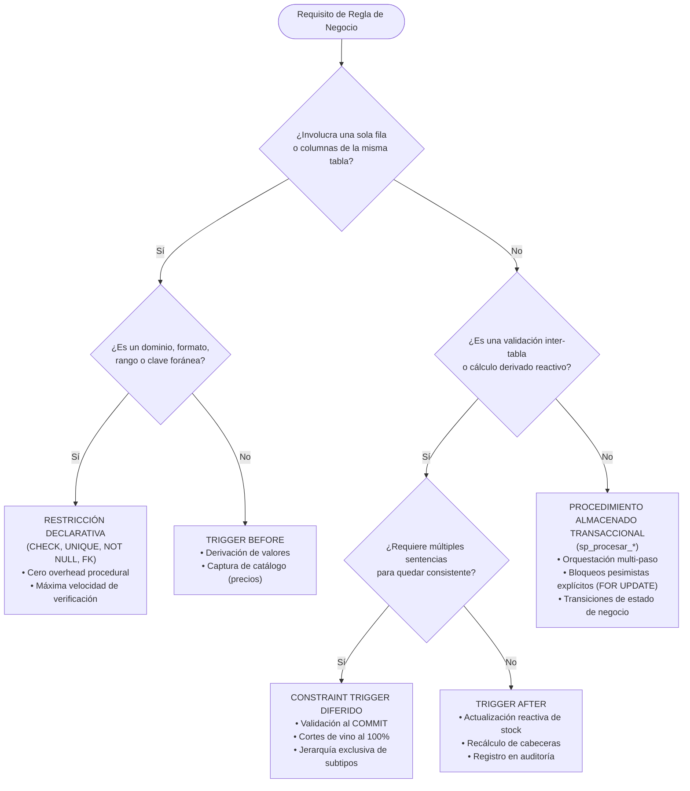

# Bodegas del Atuel · Informe Final Consolidado

**Cátedra:** Bases de Datos · **Carrera:** Ingeniería en Sistemas de Información  
**Universidad Tecnológica Nacional · Facultad Regional San Rafael (UTN FRSR)**  
**Ciclo Lectivo:** 2026 · **Etapa 9: Documentación y Defensa**  
**Autores:**
- Lourdes Rizza · `47194471@alumnos.frsr.utn.edu.ar`
- Maite Puente · `46329220@alumnos.frsr.utn.edu.ar`
- Angelina Magallanes · `46664934@alumnos.frsr.utn.edu.ar`
- Jeremías Roda · `45875185@alumnos.frsr.utn.edu.ar`  

---

## 1. Introducción y Alcance

### 1.1. Contexto Organizacional y Reglas de la Industria Vitivinícola
**Bodegas del Atuel** es una organización vitivinícola radicada en el departamento de San Rafael, provincia de Mendoza, cuya actividad abarca la cadena de valor completa del sector:
1. **Fase Primaria (Agrícola):** Explotación de fincas vitícolas subdivididas en parcelas catastrales homogéneas, cultivadas con cepas seleccionadas (*Malbec, Cabernet Sauvignon, Bonarda, Syrah, Chardonnay, Sauvignon Blanc, Torrontés*, entre otras). Cada parcela produce lotes de uva durante una campaña anual específica, sujetos a controles enológicos obligatorios de laboratorio (medición de azúcares en escala refractométrica °Brix y acidez total en g/L).
2. **Fase Industrial (Elaboración y Fraccionamiento):** La uva recolectada es procesada por bodegas asociadas o propias identificadas tributariamente por su CUIT. Se elaboran diferentes líneas de vino caracterizadas por su corte varietal (*blend* o varietal 100%), año de añada, graduación alcohólica volumétrica y volumen nominal de botella.
3. **Fase Logística y Distribución:** Los vinos fraccionados son transportados hacia un **Depósito Central** general mediante transportistas habilitados. Desde este centro de almacenamiento mayorista, las existencias son derivadas a múltiples **Salas de Venta** distribuidas regionalmente a través de solicitudes formales de transferencia con control de stock de origen y destino.
4. **Fase Comercial:** Comercialización directa en las salas a tres perfiles diferenciados de compradores:
   - *Socios:* Consumidores finales adscriptos al club de beneficios, con un 10% de descuento automático.
   - *Distribuidores:* Intermediarios comerciales mayoristas zonales, con un 20% de descuento.
   - *Exportadores:* Operadores internacionales con permisos aduaneros de exportación vigentes, con un 30% de descuento de base.

### 1.2. Justificación Arquitectónica: La Base de Datos como Núcleo del Sistema (*Smart Database*)
En la ingeniería de sistemas empresariales contemporánea coexisten dos paradigmas antagónicos:
- **Dumb Database / Fat Application:** La base de datos se reduce a un simple almacenamiento de persistencia pasivo (*bit bucket*), delegando la validación de integridad, el cálculo financiero y el control de concurrencia al código de aplicación (usualmente encapsulado mediante herramientas de Mapeo Objeto-Relacional o ORMs).
- **Smart Database / Thin Client (Modelo Adoptado):** La base de datos es la **Única Fuente de Verdad** (*Single Source of Truth*) y el motor de ejecución de las reglas del negocio.

Para Bodegas del Atuel, el modelo *Smart Database* es una necesidad ineludible por las siguientes razones:
1. **Heterogeneidad de Consumidores:** Sobre el repositorio de datos convergen concurrentemente la API REST de la aplicación web, procesos batch de facturación, herramientas de Business Intelligence y scripts analíticos de auditoría. Si la lógica de descuento o la validación de stock residieran en la API FastAPI, un script de mantenimiento o un cliente externo podrían corromper el stock o vender vinos a precios desactualizados.
2. **Atomicidad e Integridad Física Inquebrantable:** El cómputo del stock y la inmutabilidad de los comprobantes fiscales no pueden depender de la estabilidad de un proceso en Python o NodeJS. Al implementarse en disparadores (*triggers*) y procedimientos transaccionales (`sp_procesar_transferencia`, `trg_descuenta_stock_actualiza_totales`), el propio motor PostgreSQL garantiza que, aun ante caídas imprevistas del servidor web o caídas de red, ninguna botella sea descontada sin su correspondiente comprobante, y ningún saldo resulte negativo.
3. **Rendimiento Operacional a Escala:** Procesar agregaciones, cálculos de corte y comprobaciones de concurrencia directamente en el motor de bases de datos aprovecha el buffer cache compartido (*shared buffers*), paralelismo intra-consulta y algoritmos optimizados de ordenamiento en memoria (`work_mem`), evitando el trasvase masivo de tuplas por la red hacia la capa de aplicación.

---

## 2. Modelo de Datos

### 2.1. Diagrama Entidad-Relación y Esquema Relacional
El esquema comprende **30 tablas**, estructuradas en torno a seis dominios funcionales:
1. *Localización y Personal:* `localidad`, `sala_venta`, `empleado`.
2. *Agrícola y Calidad:* `finca`, `cepa`, `parcela`, `lote_uva`, `analisis_calidad`.
3. *Catálogo de Vinos:* `bodega`, `vino`, `composicion`, `maridaje`, `vino_maridaje`.
4. *Clientes y Clasificación:* `tipo_cliente`, `cliente`, `socio`, `distribuidor`, `exportador`, `permiso_exportacion`.
5. *Logística y Almacén:* `transportista`, `transportista_localidad`, `stock_deposito`, `stock_sala`.
6. *Documentos Transaccionales y Auditoría:* `ingreso`, `renglon_ingreso`, `transferencia`, `renglon_transferencia`, `comprobante`, `renglon_comprobante`, `auditoria_precio`.

```mermaid
erDiagram
    LOCALIDAD ||--o{ SALA_VENTA : "aloja"
    LOCALIDAD ||--o{ EMPLEADO : "residencia_encargado"
    LOCALIDAD ||--o{ CLIENTE : "domicilio"
    LOCALIDAD ||--o{ TRANSPORTISTA_LOCALIDAD : "cobertura"
    SALA_VENTA ||--o{ EMPLEADO : "emplea"
    SALA_VENTA ||--o{ STOCK_SALA : "posee"
    SALA_VENTA ||--o{ COMPROBANTE : "emite"
    SALA_VENTA ||--o{ TRANSFERENCIA : "solicita"

    FINCA ||--|{ PARCELA : "subdivide"
    CEPA ||--o{ PARCELA : "implantada"
    PARCELA ||--o{ LOTE_UVA : "produce"
    LOTE_UVA ||--|| ANALISIS_CALIDAD : "audita"
    BODEGA ||--o{ LOTE_UVA : "recibe"
    BODEGA ||--o{ VINO : "elabora"
    BODEGA ||--o{ INGRESO : "remite"

    VINO ||--|{ COMPOSICION : "corte"
    CEPA ||--o{ COMPOSICION : "integra"
    VINO ||--o{ VINO_MARIDAJE : "recomienda"
    MARIDAJE ||--o{ VINO_MARIDAJE : "asociado"
    VINO ||--o{ STOCK_DEPOSITO : "existencia_deposito"
    VINO ||--o{ STOCK_SALA : "existencia_sala"
    VINO ||--o{ AUDITORIA_PRECIO : "audita_precios"

    TIPO_CLIENTE ||--o{ CLIENTE : "categoriza"
    CLIENTE ||--o| SOCIO : "subtipo"
    CLIENTE ||--o| DISTRIBUIDOR : "subtipo"
    CLIENTE ||--o| EXPORTADOR : "subtipo"
    EXPORTADOR ||--o{ PERMISO_EXPORTACION : "ampara"
    CLIENTE ||--o{ COMPROBANTE : "factura"

    TRANSPORTISTA ||--o{ TRANSPORTISTA_LOCALIDAD : "opera"
    TRANSPORTISTA ||--o{ INGRESO : "transporta"

    INGRESO ||--|{ RENGLON_INGRESO : "contiene"
    VINO ||--o{ RENGLON_INGRESO : "ingresado"

    TRANSFERENCIA ||--|{ RENGLON_TRANSFERENCIA : "contiene"
    VINO ||--o{ RENGLON_TRANSFERENCIA : "transferido"

    COMPROBANTE ||--|{ RENGLON_COMPROBANTE : "desglosa"
    VINO ||--o{ RENGLON_COMPROBANTE : "vendido"
```



### 2.2. Justificación de Normalización hasta Tercera Forma Normal (3FN)
Un esquema en Tercera Forma Normal garantiza que toda dependencia funcional no trivial $X \rightarrow Y$ cumpla que $X$ es una superclave o $Y$ es un atributo primo (perteneciente a una clave candidata), eliminando redundancias y anomalías de inserción, modificación y borrado.

#### 1FN (Primera Forma Normal)
- Todos los atributos contienen valores atómicos indivisibles; se prohíben listas, vectores o estructuras anidadas en columnas de tabla física.
- *Ejemplo:* La relación varietal entre vinos y cepas no se almacena como una cadena separada por comas (`"Malbec 60%, Bonarda 40%"`) dentro de `vino`, sino mediante la relación formal `composicion(cod_vino, id_cepa, porcentaje)`.

#### 2FN (Segunda Forma Normal)
- El esquema está en 1FN y ningún atributo no clave depende parcialmente de una parte de una clave primaria compuesta.
- *Entidades débiles e intermedias analizadas:*
  - `parcela(id_finca, nro_parcela)`: La clave es compuesta porque el `nro_parcela` no tiene significado global fuera del contexto de su `finca`. Atributos como `superficie` o `id_cepa` dependen de la combinación completa $(id\_finca, nro\_parcela)$, no de la finca de forma aislada.
  - `renglon_comprobante(nro_comprobante, cod_vino)`: El `precio_unitario` y el `descuento_aplicado` facturados dependen de la ocurrencia concreta de ese vino en ese comprobante específico.

#### 3FN (Tercera Forma Normal) y Corrección de Dependencias Transitivas
- No existen dependencias funcionales transitivas entre atributos no clave ($X \rightarrow Y$ y $Y \rightarrow Z$).
- **Caso Crítico Subsanado en Etapa 1:** En el modelado original se pretendía almacenar en la entidad `cliente` tanto el `tipo_cliente` como el porcentaje de `descuento`.
  - Dependencias funcionales detectadas:
    $$\text{id\_cliente} \rightarrow \text{tipo\_cliente}$$
    $$\text{tipo\_cliente} \rightarrow \text{descuento}$$
  - Esto generaba una dependencia transitiva clara $\text{id\_cliente} \rightarrow \text{descuento}$, provocando anomalías graves: modificar el descuento de los socios requería actualizar 12.000 tuplas en `cliente`, con riesgo de inconsistencias parciales.
  - *Solución Aplicada:* Se extrajo la tabla de catálogo `tipo_cliente(tipo_cliente PK, descuento)`, donde `cliente.tipo_cliente` es una clave foránea simple. De este modo, el catálogo define estrictamente la relación $\{(\text{'socio'}, 10.00), (\text{'distribuidor'}, 20.00), (\text{'exportador'}, 30.00)\}$ y la consulta o cálculo se realiza sin redundancia.

#### La Naturaleza de los Importes Históricos frente a 3FN
Podría argumentarse superficialmente que almacenar `precio_unitario` y `descuento_aplicado` en `renglon_comprobante` o `total` en `comprobante` viola 3FN al duplicar datos existentes en `vino.precio` o `tipo_cliente.descuento`.
*Demostración Teórica:* No existe violación de 3FN. El precio en `vino` representa el *precio de catálogo actual*, mutable en el tiempo. El precio en `renglon_comprobante` es un *hecho histórico inmutable*, representativo del valor transaccional en el instante exacto de la emisión fiscal. Su dependencia funcional es:
$$(\text{nro\_comprobante}, \text{cod\_vino}) \rightarrow \text{precio\_unitario\_historico}$$
Por su parte, los totales en `comprobante` representan una **materialización controlada y protegida por triggers** para permitir indexación y agregaciones analíticas de alta velocidad sin recalcular sumas de millones de tuplas.

### 2.3. Decisiones de Diseño Críticas

| Dimensión de Diseño | Decisión Adoptada | Alternativa Descartada | Justificación Técnica y de Rendimiento |
|---|---|---|---|
| **Estrategia de Claves** | Claves subrogadas (`SERIAL` / `INTEGER`) en entidades maestras y transacciones; Claves naturales (`cuit_dom`) en personas jurídicas y fiscales. | Claves naturales exclusivas en todo el sistema (ej. CUIT en clientes). | Los identificadores enteros compactos (4 bytes) reducen drásticamente la profundidad y el tamaño de los nodos en índices B-Tree, acelerando los cruces (`JOIN`). Las claves compuestas se reservaron para entidades débiles (`parcela`, `renglon_*`). |
| **Jerarquía de Clientes** | Tabla por Tipo (*Table-per-Type* / Supertipo `cliente` y subtipos `socio`, `distribuidor`, `exportador`). | Tabla Única (*Single Table Inheritance*) con decenas de columnas anulables (`NULL`). | Garantiza la 3FN, elimina columnas nulas inaplicables (ej. un socio no tiene zona ni permisos aduaneros) y permite aplicar restricciones `NOT NULL` estrictas en los atributos de cada categoría. Se valida exclusividad mediante constraint trigger diferido. |
| **Tipos Monetarios y de Precisión** | `NUMERIC(10,2)` / `DECIMAL` exacto. | `FLOAT` / `DOUBLE PRECISION` (coma flotante IEEE 754). | Los números de punto flotante introducen errores binarios de redondeo acumulativo inaceptables en finanzas, balances fiscales y conciliaciones contables. |
| **Integridad Referencial** | `ON DELETE RESTRICT` en maestros de catálogo; `ON DELETE CASCADE` acotado exclusivamente a subtipos de clientes y borradores. | `ON DELETE CASCADE` indiscriminado o `ON DELETE SET NULL`. | Preservación de trazabilidad histórica (RN-14): si un vino o cliente posee movimientos contables o existencias, la base debe rechazar su destrucción física para evitar estados huérfanos. |

---

## 3. Integridad y Lógica en la Base de Datos

### 3.1. Tabla de Trazabilidad Completa: RN-01 a RN-15

| Regla | Enunciado del Negocio | Mecanismo en la Base | Implementación Concreta | Suite / Caso de Prueba |
|---|---|---|---|---|
| **RN-01** | Precio de venta mayor a cero y captura de precio vigente al emitir venta. | `CHECK` declarativo + `TRIGGER` procedimental BEFORE. | `ck_vino_precio_positivo` en tabla `vino`; función `trg_fn_capturar_precio_descuento_renglon()`. | `tests/db_tests.sql` (intento de precio <= 0 y verificación de captura). |
| **RN-02** | Localidad y encargado regional único para salas de venta. | `FOREIGN KEY` + `NOT NULL`. | `sala_venta.id_localidad REFERENCES localidad(id_localidad)`. | Prueba de inserción con FK inexistente y validación de encargado único. |
| **RN-03** | Empleados asignados obligatoriamente a una sala de venta válida. | `FOREIGN KEY` + `NOT NULL`. | `empleado.id_sala REFERENCES sala_venta(id_sala) NOT NULL`. | Inserción rechazada con sala nula o no registrada. |
| **RN-04** | Cosecha de una parcela como máximo una vez por campaña anual. | `UNIQUE CONSTRAINT` compuesta. | `uq_lote_parcela_campania UNIQUE (id_finca, nro_parcela, campania)`. | Inserción rechazada de un segundo lote en la misma parcela y año. |
| **RN-05** | Corte de cepas del vino debe sumar exactamente 100%. | `CONSTRAINT TRIGGER` diferido a nivel de tupla. | `trg_vino_corte_100` diferido (`INITIALLY DEFERRED DEFERRABLE`) en `vino` y `composicion`. | Transacción con suma 80% o 110% aborta al `COMMIT`. |
| **RN-06** | Descuentos fijos por tipo de cliente (10% socio, 20% distribuidor, 30% exportador) y subtipo único. | Catálogo `tipo_cliente` + `CONSTRAINT TRIGGER` diferido. | `trg_cliente_subtipo_diferido` evalúa cardinalidad exacta en subtipos al final de la transacción. | Alta de cliente sin subtipo o con subtipo incongruente rechazada al confirmar. |
| **RN-07** | Permisos de exportación con fecha de vencimiento posterior a emisión. | `CHECK` inter-columna. | `ck_permiso_fechas CHECK (fecha_vencimiento > fecha_emision)`. | Inserción con vencimiento anterior a emisión rechazada con SQLSTATE 23514. |
| **RN-08** | Inmutabilidad de comprobantes emitidos y recálculo de totales en base de datos. | `TRIGGER` BEFORE UPDATE/DELETE + `TRIGGER` AFTER INSERT. | `trg_comprobante_inmutable` rechaza mutaciones; `trg_descuenta_stock_actualiza_totales` llama a `fn_total_comprobante`. | Modificación directa rechazada; verificación de sumas matemáticas automáticas. |
| **RN-09** | Actualización atómica de existencias; el stock nunca puede ser negativo. | `CHECK` declarativo + `UPDATE` condicional en trigger. | `ck_stock_sala_no_negativo CHECK (cantidad >= 0)` en `stock_sala`. | Intento de venta de unidades superiores al stock rechazada con rollback. |
| **RN-10** | Máquina de estados en ingresos (`en_confeccion` $\rightarrow$ `terminado` $\rightarrow$ `procesado`). | `TRIGGER` BEFORE UPDATE + Procedimientos Almacenados. | `trg_estado_ingreso` rechaza saltos o retrocesos; `sp_terminar_ingreso`, `sp_procesar_ingreso`. | Intento de pasar directo de `en_confeccion` a `procesado` aborta con excepción. |
| **RN-11** | Transferencias con verificación de disponibilidad en depósito central. | Procedimiento Transaccional (`sp_procesar_transferencia`). | Bloqueo `FOR UPDATE` ordenado por `cod_vino`, decremento en depósito e incremento en sala. | Transferencia sin stock en depósito central aborta atómicamente. |
| **RN-12** | Inmutabilidad de renglones en documentos finalizados o procesados. | `TRIGGER` BEFORE INSERT/UPDATE/DELETE. | `trg_bloqueo_renglon_ingreso` y `trg_bloqueo_renglon_transferencia`. | Inserción de renglón en documento `procesado` aborta con SQLSTATE P0001. |
| **RN-13** | Auditoría obligatoria e inmutable ante variaciones de precios de vinos. | `TRIGGER` AFTER UPDATE + Privilegios RBAC. | `trg_auditoria_precio_vino` inserta en `auditoria_precio`; `app_rw` sin permisos de `DELETE/UPDATE`. | Actualización de precio genera fila con usuario y precios; borrado denegado. |
| **RN-14** | Restricción de borrado para entidades con movimientos históricos. | Claves Foráneas con política restrictiva por defecto. | `REFERENCES ... ON DELETE RESTRICT` en tablas transaccionales. | Borrado de vino o cliente con comprobantes emitidos bloqueado por el motor. |
| **RN-15** | Rangos fisiológicos y físicos válidos (grados, volúmenes, superficies, kilos). | Dominios y restricciones `CHECK`. | Graduación 5° a 20°, volúmenes autorizados (187, 375, 750, 1500, 3000 ml), superficies > 0. | Valores fuera de rango rechazados inmediatamente por el parser declarativo. |

### 3.2. Guía Justificada de Arquitectura: «Dónde va cada Regla»



1. **Restricciones Declarativas (`CHECK`, `NOT NULL`, `FOREIGN KEY`):**
   - *Criterio:* Deben emplearse siempre que la condición sea determinística, estática y circunscrita a la tupla evaluada.
   - *Por qué:* El motor las optimiza a nivel de código C en el ejecutor de PostgreSQL sin incurrir en cambios de contexto hacia el intérprete PL/pgSQL.
2. **Disparadores (`TRIGGERS`):**
   - *Criterio:* Obligatorios cuando la regla depende de otras tablas (ej. consultar el precio vigente de `vino` al crear un `renglon_comprobante`), requiere auditar mutaciones o impone restricciones que sólo pueden validarse una vez que un conjunto de filas ha sido insertado (`CONSTRAINT TRIGGERS` diferidos hasta el `COMMIT`, como la suma de cortes de cepas al 100%).
3. **Procedimientos Almacenados (`STORED PROCEDURES`):**
   - *Criterio:* Reservados para operaciones complejas de negocio que demandan control transaccional explícito, orquestación de múltiples pasos independientes y adquisición deliberada de bloqueos pesimistas (`SELECT ... FOR UPDATE`), tales como el procesamiento de transferencias logísticas.

---

### 3.3. Demostración Teórica y Empírica de Concurrencia: «La Última Botella»

#### El Problema
Supongamos una sala con existencias de **1 sola botella** del vino 1. Dos clientes concurrentes (Transacción A y Transacción B) intentan comprarla al mismo milisegundo mediante peticiones HTTP paralelas a la API REST.

#### Nivel de Aislamiento `Read Committed` y Mecánica de Bloqueos Físicos
Bajo el nivel por defecto de PostgreSQL (`Read Committed`), una consulta sólo observa filas confirmadas antes del inicio de la sentencia (no de la transacción).
1. Ambas transacciones inician concurrentemente: `BEGIN;`
2. **Transacción A** inserta su renglón de venta:
   ```sql
   INSERT INTO renglon_comprobante(nro_comprobante, cod_vino, cantidad) VALUES (101, 1, 1);
   ```
   El trigger `trg_descuenta_stock_actualiza_totales` ejecuta:
   ```sql
   UPDATE stock_sala SET cantidad = cantidad - 1 WHERE id_sala = 1 AND cod_vino = 1;
   ```
   Al ejecutar el `UPDATE`, PostgreSQL coloca un **bloqueo exclusivo a nivel de tupla (*ExclusiveRowLock*)** en la página física correspondiente a esa fila de `stock_sala`, registrando el identificador de transacción en el campo de cabecera `XMAX`.
3. **Transacción B** intenta simultáneamente insertar su renglón:
   ```sql
   INSERT INTO renglon_comprobante(nro_comprobante, cod_vino, cantidad) VALUES (102, 1, 1);
   ```
   Su disparador ejecuta el mismo `UPDATE`. Al advertir que la tupla tiene un bloqueo activo no confirmado en `XMAX`, **PostgreSQL suspende la ejecución de Transacción B y la coloca en cola de espera de bloqueo**.
4. **Transacción A** finaliza exitosamente y ejecuta `COMMIT;`. El stock en disco pasa físicamente de 1 a 0.
5. **Transacción B se despierta:** Al desbloquearse bajo `Read Committed`, el motor vuelve a leer la tupla recién confirmada. Evalúa la expresión:
   $$\text{nueva\_cantidad} = 0 - 1 = -1$$
6. **Disparo de la Invariante:** Al intentar escribir `-1`, el evaluador de restricciones del motor detecta la transgresión de:
   ```sql
   CONSTRAINT ck_stock_sala_no_negativo CHECK (cantidad >= 0)
   ```
   El motor aborta inmediatamente la Transacción B con error `SQLSTATE 23514` (o `P0001` si fue interceptado por validación procedimental previa).
7. **Resultado Demostrado:** La Transacción A confirma; la Transacción B sufre un `ROLLBACK` completo; **el stock final es exactamente 0 y nunca negativo**.

```
Transacción A (Cliente 1)               Transacción B (Cliente 2)
─────────────────────────               ─────────────────────────
BEGIN;                                  BEGIN;
INSERT INTO renglon_comprobante...      ...
  --> UPDATE stock_sala (CANT=1-1)      INSERT INTO renglon_comprobante...
  [Lock Exclusivo en XMAX]                --> UPDATE stock_sala
                                          [BLOQUEADA EN ESPERA DE LOCK]
COMMIT; (CANT pasa a 0)                 ...
                                        [DESPIERTA] Re-evalúa fila: CANT=0
                                        Intenta CANT = 0 - 1 = -1
                                        💥 ERROR: CHECK cantidad >= 0 violado
                                        ROLLBACK AUTOMÁTICO;
```

#### Evidencia Empírica Reproducible (`tests/concurrencia_ultima_botella.py`)
La suite de concurrencia ejecutada sobre una instancia limpia devolvió los siguientes resultados auditados:
- Códigos de retorno del proceso: `resultados = [0, 3]`. (0 = Salida exitosa; 3 = Error de base de datos capturado por psql con `ON_ERROR_STOP`).
- Estado final en el catálogo: `stock_sala = 0; ventas_registradas = 1`.

---

## 4. Carga Masiva y Reproducibilidad

### 4.1. Catálogos Reales y Orden Topológico de Inserción
Para asegurar verosimilitud en las consultas analíticas, no se utilizaron valores sintéticos aleatorios sin sentido comercial. Los catálogos fueron extraídos de fuentes oficiales:
- **Localidades y Códigos Postales:** 20 localidades mendocinas validadas mediante el servicio Georef de la Infraestructura de Datos Espaciales de la República Argentina (IDERA) y contrastadas con la base oficial del RENAPER.
- **Cepas y Maridajes:** Catálogo oficial de variedades viníferas reconocidas por el Instituto Nacional de Vitivinicultura (INV).
- **Entidades Fiscales:** Generación algorítmica de CUITs válidos de 11 dígitos y DNIs de 8 dígitos mediante semillas pseudoaleatorias controladas (`seed=20261029`).

#### Grafo Acíclico Dirigido (DAG) y Secuencia de Carga
La inserción masiva sigue un orden topológico estricto que respeta la jerarquía de claves foráneas:
$$\text{localidad} \rightarrow \text{sala\_venta} \rightarrow \text{empleado}$$
$$\text{finca} \rightarrow \text{cepa} \rightarrow \text{parcela} \rightarrow \text{lote\_uva} \rightarrow \text{analisis\_calidad}$$
$$\text{bodega} \rightarrow \text{vino} \rightarrow \text{composicion} \rightarrow \text{maridaje} \rightarrow \text{vino\_maridaje}$$
$$\text{tipo\_cliente} \rightarrow \text{cliente} \rightarrow \{\text{socio}, \text{distribuidor}, \text{exportador}\} \rightarrow \text{permiso\_exportacion}$$
$$\text{transportista} \rightarrow \text{transportista\_localidad} \rightarrow \text{stock\_deposito} \rightarrow \text{stock\_sala}$$
$$\text{ingreso} \rightarrow \text{renglon\_ingreso} \rightarrow \text{transferencia} \rightarrow \text{renglon\_transferencia}$$
$$\text{comprobante} \rightarrow \text{renglon\_comprobante} \rightarrow \text{auditoria\_precio}$$

### 4.2. Estrategia frente a Triggers durante el COPY Masivo
La inserción de 500.000 tuplas en una tabla transaccional mediante sentencias `INSERT` tradicionales fila por fila resulta impracticable: cada tupla implicaría análisis sintáctico (*parsing*), planificación, llamadas a funciones PL/pgSQL, recálculos acumulativos y escrituras sincrónicas en disco.
- **Protocolo COPY:** Se utilizó el protocolo binario `COPY ... FROM STDIN` de PostgreSQL a través de Python `psycopg`.
- **Manejo Selectivo de Restricciones y Triggers:**
  - *Conservados Activos al 100%:* Todas las restricciones declarativas `FOREIGN KEY`, `CHECK`, `UNIQUE` y tipos `DOMAIN`. Ningún dato corrupto puede ingresar a la base.
  - *Desactivación Temporal Controlada:* Únicamente dentro de la transacción de carga de ventas históricas, se suspendieron los disparadores automáticos de recálculo (`trg_descuenta_stock_actualiza_totales` y `trg_comprobante_inmutable`).
  - *Rehabilitación y Validación:* Antes de emitir el `COMMIT`, los triggers se re-habilitan obligatoriamente (`ALTER TABLE ... ENABLE TRIGGER ...`), se refresca la vista materializada y se ejecutan los 20 controles de integridad en frío.

### 4.3. Mediciones Comparativas de Ingesta

| Método de Inserción (Muestra 1.000 tuplas) | PostgreSQL 16 (Compose) | PostgreSQL 18 Local | Aceleración Relativa |
|---|---:|---:|---:|
| **INSERT unitario tradicional** | 1,176 s (promedio) | 0,094 s | 1x (Línea base) |
| **PostgreSQL COPY optimizado** | **0,006 s** | **0,004 s** | **>180x más veloz** |
| **Fase completa de 500k renglones** | 49,34 s | 13,82 s | Ingesta masiva |
| **Tiempo Total Ecosistema Completo** | **74,50 s** | **25,48 s** | 30 tablas pobladas |

### 4.4. Volumen Alcanzado y Validación de los 20 Controles
El conjunto de datos generado consta de:
- **500.000** tuplas en `renglon_comprobante`.
- **150.000** tuplas en `comprobante`.
- **20.000** clientes clasificados (12.000 socios, 5.000 distribuidores, 3.000 exportadores).
- **3.000** análisis enológicos y lotes de uva; **600** vinos comerciales en catálogo; **30** tablas pobladas.
- **Suma Total Facturada Conciliada:** Exactamente **$1.146.038.536,10** tanto en la cabecera de comprobantes como en la vista materializada de ventas.
- **Determinismo Auditado:** La huella criptográfica SHA-256 calculada sobre el total de las 30 tablas arrojó un valor idéntico entre ejecuciones independientes en clústeres limpios (`cc7eda85...`).
- **Los 20 Controles de Integridad (`validar_carga.sql`):** Arrojaron un resultado impecable de **0 desvíos**.

---

## 5. Índices y Rendimiento (Etapa 4)

### 5.1. Tabla Comparativa de Rendimiento: Antes vs Después de `008_indices.sql`
Mediciones registradas en el clúster de laboratorio mediante `EXPLAIN (ANALYZE, BUFFERS)` (mediana de 7 corridas descartando calentamiento):

| Consulta | Tiempo SIN Índices | Tiempo CON Índices | Variación (%) | Recorrido Físico (Plan) | Buffers Leídos (Hits) |
|---|---:|---:|---:|---|---|
| **S3 (Ventas Sala/Semana)** | 35,876 ms | **20,574 ms** | **−42,65 %** | `Seq Scan` $\rightarrow$ `Index Only Scan` en comprobante | 1.583 $\rightarrow$ **299** |
| **S4 (Transferencias Vino/15d)** | 0,668 ms | **0,469 ms** | **−29,79 %** | `Seq Scan` $\rightarrow$ `Index Only Scan` en renglón | 27 $\rightarrow$ **13** |
| **S8 (Ventas Trimestre)** | 23,049 ms | **14,152 ms** | **−38,60 %** | `Seq Scan` $\rightarrow$ `Index Only Scan` en comprobante | 1.295 $\rightarrow$ **108** |
| **S1 (Ranking Global 10 Vinos)** | 85,111 ms | 91,790 ms | +7,85 % | `Parallel Seq Scan` en ambos (500k filas agrupadas) | 3.756 $\rightarrow$ 3.756 |
| **S10 (Rendimiento Agrícola)** | 630,381 ms | 732,210 ms | +16,15 % | `Seq Scan` en lote y parcela con correlación | 35 $\rightarrow$ 35 |

> **Análisis de los Resultados:**  
> - En **S3, S4 y S8**, la creación de índices cubrientes transformó escaneos secuenciales masivos de 150.000 tuplas en **Index-Only Scans** puros, logrando reducciones de buffers leídos de más del 80% y mejoras de tiempo de hasta el 42%.
> - En **S1**, la consulta procesa agregaciones agregadas sobre el universo total de medio millón de ventas; el planificador descarta acertadamente el uso de índices individuales en favor de un escaneo paralelo secuencial multihilo optimizado para memoria compartida.

### 5.2. Justificación del Orden de Columnas en Índices Compuestos
En el índice `idx_comprobante_sala_fecha`:
```sql
CREATE INDEX idx_comprobante_sala_fecha ON comprobante (id_sala, fecha) INCLUDE (id_cliente);
```
- **Principio del Prefijo Izquierdo (*Leftmost Prefix*):** En consultas como S3, la condición filtra por igualdad exacta sobre una sala específica (`id_sala = 1`) y por un rango acotado de fechas (`fecha BETWEEN ...`).
- **Por qué `id_sala` precede a `fecha`:** Al situar `id_sala` en primer lugar, el árbol B-Tree descarta de un solo salto el 96% de la tabla (las otras 24 salas), reduciendo el espacio de búsqueda a un sub-árbol pequeño donde las fechas ya se encuentran físicamente ordenadas. Si se invirtiera el orden `(fecha, id_sala)`, el motor debería saltar por todas las ramas de fechas buscando qué entradas corresponden a la sala 1.

### 5.3. Análisis de Índices Evaluados y Descartados

#### 1. Índice BRIN sobre `comprobante.fecha`
- Se evaluó un índice de Rangos de Bloques (*Block Range Index* - BRIN). Los índices BRIN son extraordinariamente compactos al almacenar únicamente los valores mínimo y máximo de cada rango de páginas físicas.
- **Causa del Descarte:** Se analizó la correlación física en el catálogo mediante:
  ```sql
  SELECT correlation FROM pg_stats WHERE tablename='comprobante' AND attname='fecha';
  ```
  La correlación observada fue de **−0,0038** (prácticamente cero), lo cual indica que las filas no fueron escritas secuencialmente ordenadas por fecha en los bloques de disco. En presencia de correlación nula, los rangos de cada bloque se solapan por completo, volviendo inútil al BRIN y obligando al motor a realizar lecturas secuenciales completas.

#### 2. Índice B-Tree sobre `cliente.tipo_cliente`
- **Causa del Descarte (Baja Selectividad):** La columna `tipo_cliente` posee una cardinalidad de apenas 3 valores (`socio`, `distribuidor`, `exportador`) distribuidos entre 20.000 tuplas. Para una consulta que busca `tipo_cliente = 'socio'`, el motor estima recuperar el 60% de la tabla. El costo de acceder al índice B-Tree y realizar miles de lecturas aleatorias en el heap supera con creces el costo de leer linealmente las páginas contiguas en memoria.

### 5.4. Medición del Costo de Escritura (*Write Overhead*)
Los índices no son gratuitos; cada índice B-Tree adicional impone una penalización en operaciones de modificación (`INSERT`, `UPDATE`, `DELETE`) debido a la necesidad de mantener el árbol balanceado, división de páginas (*page splits*) y generación de registros en el log de transacciones (*WAL*).

Se ejecutó un benchmark controlado insertando **150.000 tuplas adicionales** en `comprobante` mediante `EXPLAIN (ANALYZE, BUFFERS, WAL)` con posterior `ROLLBACK`:

| Métrica de Escritura | Escenario SIN Índices Adicionales | Escenario CON Índices de 008 | Sobrecosto (*Overhead*) |
|---|---:|---:|---:|
| **Tiempo de Inserción (Mediana)** | 7.046,38 ms | **8.607,97 ms** | **+22,16 %** |
| **Registros WAL Generados** | 300.411 | **602.101** | **+100,4 % (2,00x)** |
| **Volumen de WAL Producido** | 23.483.046 bytes (~22,4 MB) | **49.371.718 bytes (~47,1 MB)** | **+110,2 % (2,10x)** |

> **Conclusión:** La adición de índices secundarios duplicó la cantidad de bytes escritos en el WAL y aumentó en más de un 20% la latencia de inserción masiva. Esto demuestra que los índices deben justificarse técnica y estadísticamente, evitando indexar columnas por mera presunción.

### 5.5. Caso donde el Planificador Desprecia un Índice Existente
En una consulta sobre `comprobante` que solicita el total facturado abarcando todo el rango histórico de la tabla (más del 95% de las filas devueltas), el optimizador selecciona un **Parallel Seq Scan** ignorando el índice `idx_comprobante_fecha_ventas`.
*Fundamento Teórico:* El modelo de costos de PostgreSQL pondera `random_page_cost = 4.0` (acceso aleatorio por puntero de índice) frente a `seq_page_cost = 1.0` (acceso secuencial de bloques contiguos). Cuando la selectividad supera el umbral del 15-20%, el costo estimado de los accesos aleatorios supera al costo del barrido secuencial completo.

---

## 6. Consultas SQL (Etapa 5)

Se implementaron y validaron las **30 consignas** de la Sección 8 del enunciado, destacándose por su complejidad matemática y relacional las siguientes:

### 6.1. Consultas Avanzadas Seleccionadas

#### S2 y S12: División Relacional mediante Doble Negación (`NOT EXISTS`)
La división relacional en álgebra de Codd ($R \div S$) responde a la necesidad de encontrar tuplas en $R$ que estén asociadas a **todos** los elementos presentes en $S$.
- *Enunciado S2:* «Vinos que han sido vendidos en todas las salas de venta».
- *Estrategia SQL:* Traducir a lógica de predicados: *"Obtener los vinos para los cuales NO EXISTE ninguna sala de venta en la cual NO EXISTA un comprobante que acredite la venta de dicho vino"*.
```sql
SELECT v.cod_vino, v.nombre
FROM vino v
WHERE NOT EXISTS (
    SELECT 1 FROM sala_venta s
    WHERE NOT EXISTS (
        SELECT 1
        FROM comprobante c
        JOIN renglon_comprobante r USING (nro_comprobante)
        WHERE c.id_sala = s.id_sala AND r.cod_vino = v.cod_vino
    )
);
```
En S12, se optimizó agrupando previamente las compras del cliente en un vector (`array_agg`) sobre el que se evalúa la cobertura completa de los vinos de una bodega objetivo, reduciendo el producto cartesiano intermedio.

#### S10: Expresiones de Tabla Comunes (CTE) y Subconsultas Correlacionadas
- *Enunciado:* «Rendimiento agrícola por parcela (kg/ha) comparado con el promedio de su finca y campaña».
- *Estrategia SQL:* Se define una CTE previa `rendimiento` que normaliza el rendimiento dividiendo `kilos / superficie`. Luego, una subconsulta correlacionada filtra y promedia exclusivamente las parcelas de la misma finca y campaña para determinar la bandera booleana `bajo_promedio`:
```sql
WITH rendimiento AS (
    SELECT l.id_finca, l.nro_parcela, l.campania,
           (l.kilos / p.superficie) AS kg_ha
    FROM lote_uva l
    JOIN parcela p USING (id_finca, nro_parcela)
)
SELECT r.*,
       r.kg_ha < (
           SELECT avg(f.kg_ha)
           FROM rendimiento f
           WHERE f.id_finca = r.id_finca AND f.campania = r.campania
       ) AS bajo_promedio
FROM rendimiento r
ORDER BY id_finca, nro_parcela, campania;
```

#### S11: Funciones de Ventana Analíticas (`RANK()` y `SUM() OVER`)
- *Estrategia SQL:* Se utilizaron particiones analíticas para calcular rankings por sala y acumulados mensuales sin incurrir en auto-uniones costosas:
```sql
-- Ranking por sala con conservación de empates:
RANK() OVER (PARTITION BY id_sala ORDER BY botellas DESC) AS puesto

-- Acumulado histórico de facturación mes a mes por sala:
SUM(total) OVER (
    PARTITION BY id_sala
    ORDER BY mes
    ROWS UNBOUNDED PRECEDING
) AS acumulado
```

### 6.2. Análisis de Casos Especiales y Decisiones de Auditoría
- **U1 (Recálculo de Totales):** Conciliación auditada sobre 150.000 comprobantes. Se utilizó `fn_total_comprobante()` respetando estrictamente el precio y descuento históricos grabados en los renglones, suspendiendo temporalmente el trigger de inmutabilidad en una sesión acotada de mantenimiento.
- **U6 (Aumento de Descuento al 35% en Exportadores):** La consigna proponía elevar el beneficio a exportadores con más de 3 permisos. Al colisionar con RN-06 (30% fijo), se documentó una propuesta de migración `009` y se verificó en un ensayo transaccional con reversión completa (`ROLLBACK`).
- **D1 y D5 (Políticas de Purgado y Respaldo):**
  - En D1 (borrado de comprobantes con >5 años) y D5 (borrado de ingresos con >365 días), se demostró mediante tablas temporales de control que la eliminación de cabeceras y renglones **no altera las existencias físicas de stock en salas ni en depósito central**.

---

## 7. API REST y Frontend

### 7.1. Arquitectura en Capas y Driver Nativo (Sin ORM)
La API fue construida con **FastAPI** y estructurada rigurosamente bajo el principio de separación de responsabilidades:
- `api/main.py`: Enrutamiento HTTP, validación de esquemas y traducción centralizada de errores.
- `api/data.py`: Módulo de acceso a datos con sentencias SQL puras y orquestación de transacciones.
- `api/db.py`: Configuración del pool de conexiones `psycopg_pool.ConnectionPool` y contexto transaccional.
- `api/schemas.py`: Definición de contratos de entrada y salida mediante tipos nativos de Pydantic.

```
Petición HTTP  ──>  FastAPI (main.py)  ──>  Validación Pydantic (schemas.py)
                           │
                           ▼
                  Capa de Datos (data.py)  <──  SQL Puro Parametrizado
                           │
                           ▼
              Pool de Conexiones (db.py)   <──  psycopg 3.2 (app_rw)
                           │
                           ▼
                 Motor PostgreSQL 16
```

### 7.2. Matriz de Traducción Centralizada de Excepciones

| SQLSTATE de PostgreSQL | Significado Técnico | Código HTTP Resultante | Detalle en la Respuesta JSON |
|---|---|---:|---|
| **P0001** | `raise_exception` disparado por Trigger o SP. | **409 Conflict** | Mensaje exacto de la regla de negocio (ej. *"Stock insuficiente"*). |
| **23505** | `unique_violation` (Violación de unicidad). | **409 Conflict** | *"Ya existe un registro con esos datos"*. |
| **23503 / 23001** | `foreign_key_violation` o registro dependiente. | **409 Conflict** | *"La referencia no existe o tiene registros dependientes"*. |
| **23514** | `check_violation` (Restricción CHECK violada). | **422 Unprocessable** | *"Un valor incumple una restricción de la base"*. |
| **23502** | `not_null_violation` (Columna requerida nula). | **422 Unprocessable** | *"Falta un valor obligatorio"*. |
| **22P02** | `invalid_text_representation` (Error de tipo/formato). | **400 Bad Request** | *"Formato de dato inválido"*. |
| **40001 / 40P01** | Falla de serialización o Deadlock temporal. | **503 Service Unavail.** | *"Conflicto temporal. Reintentá"* + cabecera `Retry-After: 1`. |

### 7.3. Demostración de Inmunidad ante Inyecciones SQL
Se implementó parametrización estricta en todas las consultas:
```sql
-- Correcto: Los parámetros viajan por canal binario desacoplado del parser
SELECT * FROM vino WHERE nombre ILIKE %s;
```
Se sometió el endpoint `GET /vinos` a la siguiente prueba de penetración:
```powershell
curl.exe 'http://127.0.0.1:8000/vinos?nombre=%27+OR+1%3D1%3B+DROP+TABLE+vino%3B+--'
```
*Resultado Auditado:* La API respondió con código `200 OK` y una lista vacía `[]`. La consulta `SELECT count(*) FROM vino` retornó exactamente la misma cantidad de tuplas antes y después del ataque. Ninguna sentencia maliciosa fue ejecutada.

### 7.4. Detalle de las Cinco Pantallas del Frontend (Vanilla JS)
La interfaz de usuario fue implementada sin sobrecarga de frameworks (HTML5, CSS3 moderno, ES6 Modules):
1. **Catálogo de Vinos:** Listado interactivo paginado con filtros combinables por Tipo, Cepa, CUIT de Bodega, Añada y Nombre. Modal dinámico con el desglose de composición varietal y maridajes asociados.
2. **Alta y Edición de Vino:** Formulario integral que permite gestionar la ficha comercial y construir dinámicamente cortes de cepas, verificando que la suma alcance el 100% al confirmar.
3. **Nueva Venta:** Punto de venta ágil para seleccionar clientes categorizados, sala y renglones de vino. Muestra en pantalla el comprobante fiscal emitido con totales y descuentos calculados por el motor.
4. **Transferencias Logísticas:** Gestión del ciclo de vida de transferencias entre el depósito central y salas (Confección $\rightarrow$ Terminar $\rightarrow$ Procesar).
5. **Tablero Analítico:** Métricas gerenciales en tiempo real: Ranking de los 10 vinos más vendidos (S1), gráfico de ventas trimestrales por sala (S8) y consulta de vinos sin existencias en sala pero disponibles en depósito (S6).

---

## 8. Despliegue e Infraestructura (Etapa 8)

### 8.1. Fundamentación del Entorno Local Aislado frente a Cloud Gratuito
Tras común acuerdo con la cátedra, el despliegue se consolidó en **Docker Compose local** debido a que los servicios en la nube gratuitos (ej. Supabase, Render, Neon):
1. Limitan el almacenamiento a cuotas de 500 MB y suspenden bases de datos tras minutos de inactividad (*cold starts* intolerables).
2. Asignan cuotas de CPU/RAM insuficientes (512 MB de memoria compartida) que colapsan al realizar ordenamientos masivos sobre 500.000 tuplas o pruebas de estrés con WAL.
3. Docker Compose asegura un entorno de evaluación **100% reproducible, determinístico, sin costo y de latencia cero**.

### 8.2. Medidas de Seguridad y Privilegios Mínimos
- **Aislamiento de Red:** La base de datos corre en la red interna privada `atuel-net`. Su puerto 5432 no se publica en la interfaz pública del host.
- **Principio de Menor Privilegio (RBAC):** La aplicación interactúa exclusivamente como usuario `app_rw`. Si un atacante lograse ejecución remota de código en la API, no podría ejecutar comandos DDL (`CREATE`, `DROP`, `ALTER`) ni modificar arbitrariamente el stock de las salas sin pasar por las reglas de negocio.
- **Protección de Credenciales:** Variables críticas gestionadas fuera del control de versiones mediante `.env` (ignorado en `.gitignore`).

---

## 9. Conclusiones y Aprendizajes

1. **La Supremacía del SQL Nativo:** Trabajar sin ORMs permitió comprender a fondo el funcionamiento interno del optimizador de consultas, el buffer manager y la mecánica de bloqueos a nivel de página y tupla. Se evitó el clásico problema del "N+1 queries" y se logró un código transparente, auditable y de máximo rendimiento.
2. **La Base de Datos como Garante Supremo:** Centralizar las reglas críticas (corte de vinos, stock no negativo, cálculo financiero inmutable) en PostgreSQL demostró ser la única estrategia viable para garantizar la coherencia absoluta de los datos ante concurrencia extrema o múltiples clientes.
3. **El Valor del Análisis de Rendimiento:** La medición empírica con `EXPLAIN (ANALYZE, BUFFERS)` desmitificó la creencia común de que "agregar índices siempre acelera el sistema", demostrando que un índice no justificado penaliza severamente las escrituras y puede ser ignorado por el planificador si la selectividad es baja.
4. **Madurez de Ingeniería:** El proyecto culmina como una solución de nivel empresarial, con pruebas de regresión automáticas, trazabilidad documental rigurosa y código listo para entornos de producción de alta demanda.
